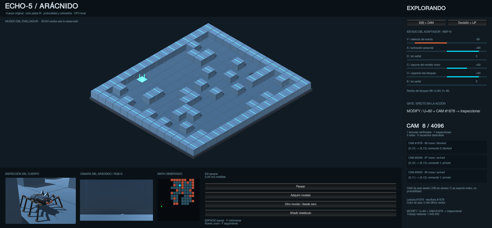

# E[6] y CAM en el arácnido — 12 de octubre de 2026

**Versión vigente:** [cierre 1.0](CLOSURE-1.0.md). Añade persistencia contextual,
extinción física, control del segundo encuentro, misiones Station e inspector
causal. Las cifras de la integración inicial que siguen se conservan como historial.

**Actualización posterior:** se corrigió la detención durante la calibración fría y la confusión de estados del panel. La versión corregida pasó 114 tests y completó 8/8 mapas de desarrollo en Unity. [Diagnóstico y evidencia](PAUSE-RECOVERY.md). Las cifras 110 y 3/4 que siguen corresponden a la tanda inicial de integración.

La demo del puerto 8771 instancia `ArachnidAgent`, una extensión del navegador actual. Reutiliza `navi10_cam.Cam` (4.096 ranuras), `navi10_wsp` (WSP16), el codificador semántico `nexus0.encoder` y `nexus0.gate`. El navegador predeterminado y el servicio original 8770 conservan su comportamiento. No se modifica el núcleo histórico de ECHO ni se añade un LLM.

## Ciclo real

1. Unity mide profundidad, pose y resultado del último movimiento/giro.
2. El protocolo existente vincula el recibo con sesión, secuencia, comando y pose previa. Una repetición HTTP devuelve los mismos bytes, sin aprender ni almacenar dos veces.
3. El adaptador actualiza E[6] y guarda en CAM los movimientos unitarios confirmados, giros confirmados o bloqueos estacionarios. Cancelaciones y recibos incongruentes no se convierten en hechos.
4. Un bloqueo eleva U a 80. Una lectura exacta de CAM, con extracto verificado, permite al gate original convertir la pausa tras fallo en una inspección de cámara. No se inventa un desplazamiento para representar AVOID.
5. Si se vuelve a proponer un comando bloqueado en ese contexto, CAM puede vetarlo. Los rayos nuevos que refutan el bloqueo o un cambio de época del modelo retiran su efecto. El episodio histórico permanece conservado.
6. Unity muestra el resultado y colorea los sensores según U. El HUD no escribe en la política.

Las reglas de adaptación y del gate están programadas. Los episodios, mapa y efectos de comandos se adquieren de las ejecuciones. La integración no demuestra que una emoción o el mecanismo de control hayan sido aprendidos.

## Señales y costes

| Canal | Señal de esta demo |
|---|---|
| V | −80 tras bloqueo, +40 en la meta confirmada, 0 en los demás casos, a partir del codificador existente. No es el error TD. |
| A | 80 tras bloqueo; en otro caso `min(80, 20 + 3 × celdas nuevas)`. |
| D | 0: sin señal física para este canal. |
| C | `100 × suma(min(2, soporte_por_comando)) / 8`, con división entera. Es cobertura de calibración; no certeza absoluta. |
| U | 80 tras bloqueo; después decae por observación hasta el suelo 10, con redondeo que evita quedarse atascado. |
| B | 0: sin señal física para este canal. |

Los seis canales permanecen en −100…100 dentro del WSP de 16 bytes. La navegación no mide batería, temperatura ni dolor biológico. Station sí transmite su batería simulada: menos de 25 eleva U a 80; misión confirmada produce V=40 y una puerta cerrada sin llave deja un hecho temporal verificable. La relación de estas señales con el cuerpo es una convención explícita de ingeniería.

La CAM persistente usa contexto exacto `(mundo, dimensiones, época y significado motor, origen, comando)`; el modo aislado conserva además la sesión. La semejanza de hash no permite transferir un veto a otro lugar o mundo. Se comprueban extracto, procedencia, contexto y distancia de Hamming antes de usar un recuerdo. El hecho guardado es «este intento tuvo este resultado», no «el destino predicho contiene necesariamente una pared».

El servicio 8771 guarda y restaura automáticamente las 4.096 posiciones de CAM en un JSON versionado con SHA-256. Los episodios y sus fuentes permanecen inmutables; las inferencias de bloqueo se pueden retirar al recibir profundidad nueva. `--no-persistence` conserva el modo aislado. El guardado del modelo motor y del mapa sigue siendo un mecanismo distinto: la memoria de una amenaza no determina por sí sola qué significa un comando. El perfil `no_memory` desactiva el uso de CAM en las decisiones, aunque los recibos siguen disponibles para auditoría.

El presupuesto de 2.000.000 incluye actualización, verificación de extractos y escritura en CAM (cobro conservador de hasta 4.096 sondeos más bytes del extracto). Llenar CAM omite nuevas escrituras, sin destruir recuerdos; agotar presupuesto detiene las acciones. Este coste lógico no mide tiempo, energía ni memoria RAM.

## Visibilidad y evidencia

La pestaña **E[6] + CAM** muestra seis barras, causa del cambio, última intervención del gate, ocupación y recibos recientes. **Decisión + LIF** conserva hipótesis, evidencia y los 256 elementos del observador LIF. Ese observador sigue sin conducir la política; conectarlo sería otra intervención experimental.

Todos los eventos usan el Recorder existente y su cadena de hashes: `arachnid_e6`, `arachnid_cam_write`, `arachnid_cam_read` y `arachnid_gate`. `/diagnostic` es de solo lectura del actor; sus consultas no avanzan E, CAM, aprendizaje o presupuesto.

La suite completa tiene 110 pruebas, incluidas 13 del adaptador: rechazo de falsos recibos, repetición idempotente, refutación, contexto, capacidad, presupuesto y diagnóstico pasivo. Una ablación de un fallo físico idéntico devuelve **scan con E[6]+CAM** y **move al desactivar cualquiera de los dos controles**. Es evidencia causal de esa decisión, no de mayor tasa de éxito.

En cuatro mundos CPU emparejados, navegador original y adaptador completan **3/4**; ambos fallan en el mismo mundo. El coste lógico aumenta al registrar CAM. No se afirma una mejora general de navegación ni se oculta el fallo previo. Resultados y costes por brazo: `Logs/Arachnid/basal-tests-r3.log` (110 pruebas pasadas; incluye la ablación causal de la acción).

El editor admite `-arachnidBlockProbe`: en desarrollo, coloca **un obstáculo físico después de una propuesta** cuando se han adquirido los cuatro comandos. La intervención se registra en el log de Unity; los recibos posteriores proceden del controlador físico habitual. La opción está desactivada por defecto.

Auditoría independiente del código del actor, usando solo la biblioteca estándar:

```sh
python3 Tools/audit_arachnid_state.py /ruta/al/thought.jsonl --output /ruta/a/audit.json
```

Revisa cadena de hashes, recibos respecto de las propuestas, WSP16, evolución de U, escrituras/lecturas y efectos del gate. Necesita una sesión cerrada. Esto comprueba consistencia del simulador y del registro; no es una validación sobre hardware real.

## Ejecución en Unity

La ejecución `98e13ef8c4b1450186529640a505a9e7` llegó a la meta desde cero con el obstáculo de prueba activado:

- 30 intentos de movimiento: 29 llegadas unitarias y un bloqueo. Ningún fallo repetido.
- 4 inspecciones; una activada por U=80 y el recibo verificado de CAM #1596.
- 34 episodios almacenados, 0 destruidos; 236.180 de las 2.000.000 unidades lógicas.
- 35 decisiones del servidor, incluida la decisión terminal; el contador de secuencia de Unity termina en 34.
- Cierre confirmado por el servidor; pose finita y un mínimo de cuatro apoyos visuales.
- Auditoría de 277 eventos válida. Consultar `/diagnostic` después del cierre no modificó el diario.

El veto de un movimiento repetido se verificó en pruebas de componente; en esta ejecución no hizo falta: el planificador ya evitó la arista fallida. La intervención observada en vivo fue la inspección adicional tras bloqueo.

[Auditoría del diario](basal-live-audit-20261012.json) · [Recibo de Unity](../../Evidence/2026-10-12/Logs/Arachnid/unity-basal-result.json) · [Manifestación de archivos y hashes](basal-verification-20261012.json).


