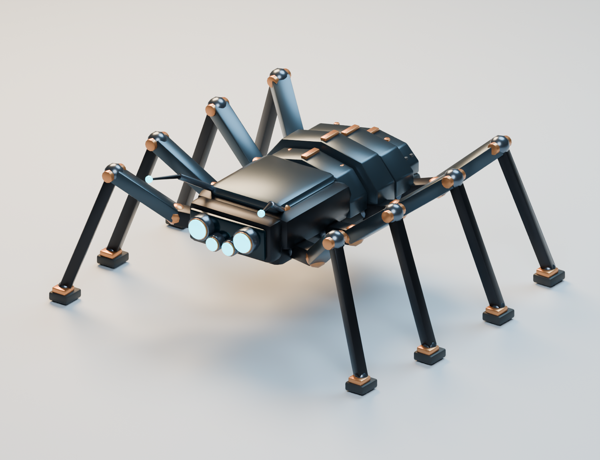
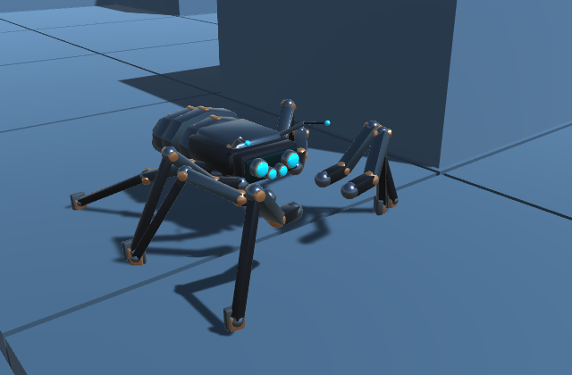
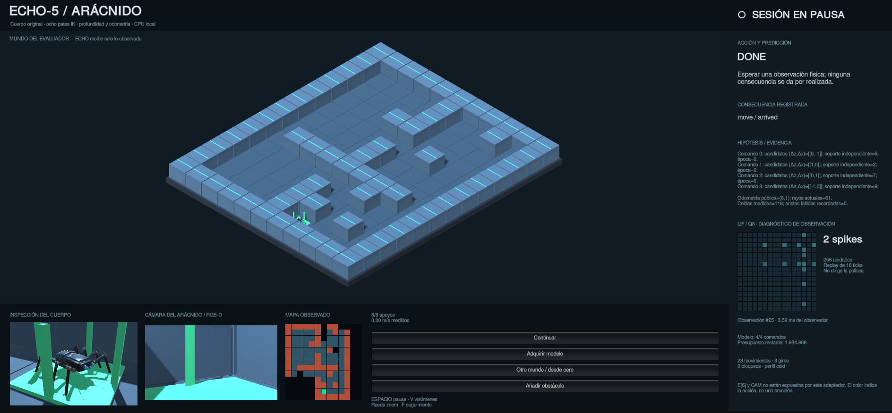
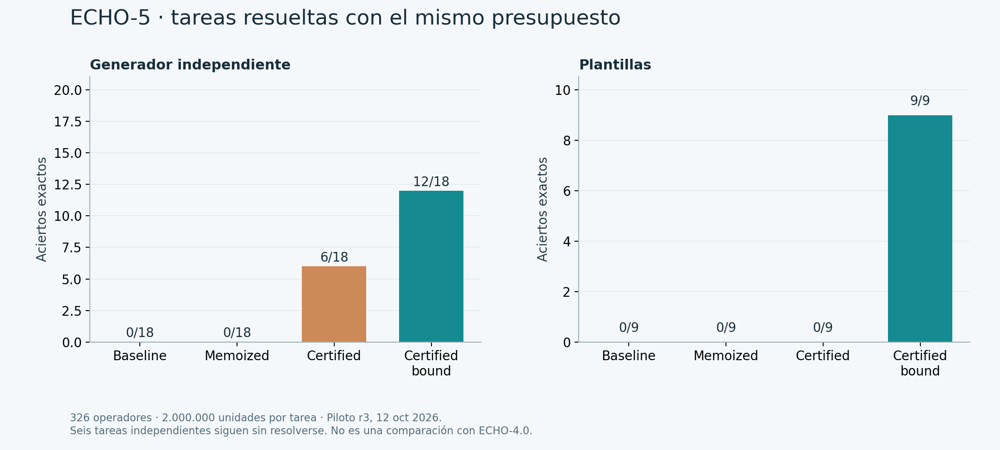
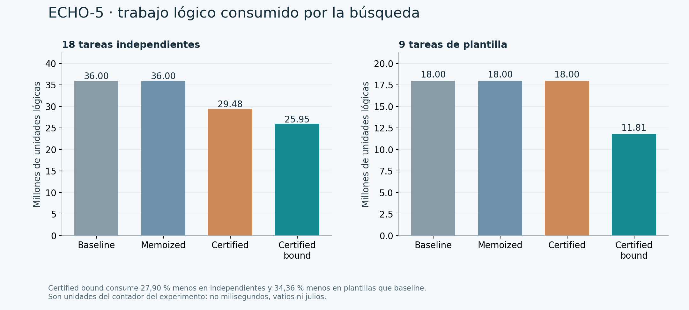
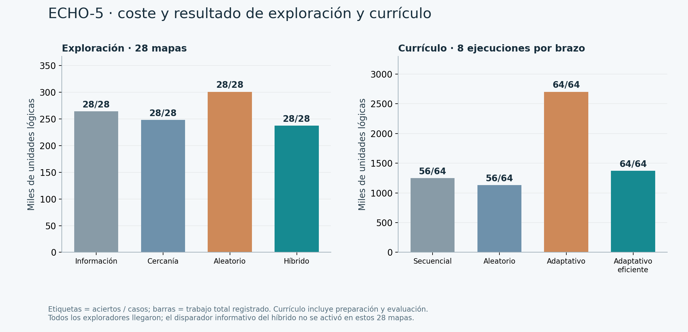

# ECHO-5 · Arácnido biónico

Modelo original construido en Blender y conectado al navegador existente de ECHO-5 en Unity. La escena es `Assets/Scenes/ECHO5_ArachnidLab.unity`; conserva las escenas anteriores de estación y navegación. Fecha: 12 de octubre de 2026.

**Integración 1.0:** CAM persistente y revisable, tres misiones con este cuerpo,
inspector causal y comprobación conjunta de recursos, aislamiento y mapas
nuevos. [Contrato de cierre y resultados vigentes](CLOSURE-1.0.md).
Los conteos de pruebas y ejecuciones anteriores que aparecen más abajo son
evidencia histórica, no el resultado de la nueva confirmación.



## Abrir y usar

**Corrección de detenciones:** el arranque desde cero ya recupera la calibración mediante recorridos confirmados; pausa manual, bloqueo y finalización aparecen por separado. Se verificaron 8/8 mapas de desarrollo y 114 pruebas Python. [Diagnóstico y resultados](PAUSE-RECOVERY.md) · [Estado de las cuatro demos](DEMO-STATUS.md).

Desde la raíz de ECHO-Station:

```sh
python3 Tools/start_arachnid.py
```

El lanzador reutiliza el puente propio en `127.0.0.1:8771` y abre Unity y Blender, solicitando los workspaces 2 y 3 de Hyprland. Si Unity ya está abierto, sal de Play y utiliza **ECHO → Arácnido → Abrir laboratorio**. La demo comienza desde cero en el primer mapa de desarrollo. Una recarga del editor no debe cambiar ese perfil por uno que requiera un modelo entrenado.

El workspace 1 queda para el terminal. Se pueden configurar `ECHO5_SOURCE`, `UNITY_EDITOR` y `BLENDER_EDITOR`; no se instala nada dentro del proyecto legado de Discord ni se necesita un LLM. `--bridge-only` inicia solo el servicio y `--no-blender` evita abrir el modelador.

En la demo:

- **Espacio / Pausar:** pausa o continúa la misma sesión.
- **F / rueda / botón central:** seguimiento, zoom y desplazamiento de la cámara isométrica.
- **V:** muestra las cápsulas de colisión anticipada del motor existente.
- **Otro mundo / desde cero:** abre otro mapa de desarrollo con una sesión nueva.
- **Adquirir modelo:** abre el modo de adquisición existente; sus observaciones se guardan en el almacén de esta demo.
- **Añadir obstáculo:** cambia físicamente una celda del mundo; el agente debe observar sus consecuencias.

El botón de otro mundo usa el perfil frío. No presenta ese cambio como una prueba nueva de transferencia del modelo guardado.

## Modelo y rig

- Colección `ECHO5_Arachnid`, jerarquía bajo `Chassis_Root`, origen en el suelo y unidades métricas.
- Envolvente de **1,064 × 0,898 × 0,439 m**. Ocho patas simétricas, cuatro lentes y dos antenas.
- Chasis frontal biselado, abdomen segmentado, ventilación, detalles de cobre, articulaciones y almohadillas de apoyo.
- Cada pata tiene pivotes `Leg_L0_Coxa/Femur/Tibia/Foot`, hasta L3 y R0–R3. Es una jerarquía rígida animable, no un esqueleto humanoide ni una armadura con pesos de skinning.
- **11.816 vértices y 22.972 triángulos**, repartidos en 48 mallas. Bisel aplicado, normales recalculadas y sombreado suave con aristas marcadas. El informe registra cero vértices sueltos, cero bordes no manifold y cero mallas con volumen firmado negativo.
- `Mat_Chassis_Dark`: grafito `#1E2024`, metálico 0,8 y rugosidad 0,35.
- `Mat_Mechanical_Joints`: acero; `Mat_ECHO_Eye_Emission`: cian `#00E5FF`, emisión 5. Los materiales auxiliares separan cobre, paneles, cristal y goma.
- La importación verifica escala, apoyo en Y=0, 32 pivotes y cuatro ojos. Orienta el frente óptico hacia +Z de Unity; Blender conserva su frente en −Y.

La cinemática inversa mueve grupos alternos de cuatro patas a partir del desplazamiento real del chasis. Los apoyos consultan el suelo y las extremidades conservan sus longitudes. Es animación procedural: no es locomoción aprendida, ragdoll ni simulación dinámica de ocho patas. La colisión y el movimiento del chasis siguen a cargo del `PredictiveMotor` existente.

## Qué decide ECHO y qué muestra la pantalla

El navegador recibe profundidad obtenida con rayos, odometría del simulador, objetivo y consecuencias de la última acción. Acumula un mapa observado e induce los efectos de cuatro comandos discretos. La planificación de rutas, el muestreo de sensores y el motor que ejecuta esos comandos son algoritmos programados. El agente no recibe el plano privado del evaluador.

La cámara RGB en primera persona existe y comparte el montaje sensorial; esta demo no incorpora reconocimiento de objetos a partir de píxeles RGB. El panel muestra hipótesis, evidencia, predicción, consecuencia, mapa aprendido y presupuesto procedentes de `NavigationClient`. El diario sigue siendo el `thought.jsonl` de `Recorder`.

El panel de **256 unidades LIF Q8** ejecuta el observador real `echo5.neural_observer.NeuralObserver` sobre cada observación. Reproduce sus 16 ticks medidos y muestra su coste aparte. Este observador **no elige acciones ni altera el presupuesto del actor**. Una vez cerrada la sesión conserva la última lectura; no reabre el agente ni escribe en su diario cerrado.

El adaptador ya conecta **E[6], CAM y el gate original** al ciclo del agente. La pestaña **E[6] + CAM** muestra valores enteros, su origen, recibos recientes y cambios de acción. Los ojos representan U (urgencia tras bloqueo). D y B permanecen a cero porque esta demo no ofrece sus señales; C mide soporte del modelo motor, no una probabilidad de verdad. [Contrato de integración y límites](E6-CAM.md).

## Reproducir el asset

Ejecutar en una instancia nueva: el generador limpia la escena activa de Blender.

```sh
blender \
  --background --factory-startup --threads 2 \
  --python Tools/build_arachnid.py -- --render
```

Después, fuera de Play, **ECHO → Arácnido → Construir prefab y laboratorio** reconstruye solo el prefab y la escena del arácnido. Este comando reemplaza cualquier edición manual de esa escena.

Los archivos editables y exportados están en:

- [Blender](../../ArtSource/ECHO5_Arachnid/ECHO5_Arachnid.blend), [glTF binario](../../ArtSource/ECHO5_Arachnid/ECHO5_Arachnid.glb), [FBX](../../Assets/EchoArachnid/Models/ECHO5_Arachnid.fbx).
- [Generador completo](../../Tools/build_arachnid.py) e [informe de geometría](../../ArtSource/ECHO5_Arachnid/geometry-report.json).
- Prefab Unity: `Assets/EchoArachnid/Prefabs/ECHO5_Arachnid.prefab`.

El Blender del sistema presenta una incompatibilidad de símbolos de MaterialX. Se utilizó una copia portátil oficial de Blender **4.5.3 LTS**, sin cambiar paquetes del sistema. El archivo descargado tiene SHA-256 `975c58fcb244273838534bba771e64ad87739216b0f9b39a888531a49a72d845`; el recibo de instalación está en `~/.local/opt/blender-4.5.3-installation.json`.

## Comprobaciones

**Actualización E[6]/CAM:** 110 pruebas pasadas; la demo con un obstáculo físico sobrevenido completó la misión y guardó 34 recibos. Hubo una inspección causada por U y CAM; la auditoría del diario pasó. [Resultados, límites y captura](E6-CAM.md#ejecución-en-unity). Los recibos que siguen describen la demostración anterior, antes de esta conexión.

```sh
python3 -B \
  -m unittest discover -s Bridge/tests -v
```

La suite del puente tiene **97 pruebas pasadas** en `Logs/Arachnid/python-tests-r2.log`. Tres comprueban específicamente que el diagnóstico usa la capa real, mantiene iguales las acciones posteriores y no modifica diarios cerrados. Las comprobaciones de importación están en `Logs/Arachnid/unity-import.json`; la demo escribe `unity-demo-result.json`, `unity-live.png` y `unity-body.png` en esa carpeta.

El recibo de demo registra conexión, llegada, acuse de cierre del servidor, decisiones, bloqueos, frames animados, mínimo de apoyos y coordenadas finitas. Es una prueba de integración en un mapa de desarrollo, no una nueva confirmación científica ni una evaluación reservada. Los primeros intentos de depuración se conservan como tales.

La ejecución final desde cero llegó a la meta en **26 decisiones y 23 movimientos, con 0 bloqueos**. Registró 1.511 frames de pose, 1.202 con algún grupo de patas en movimiento y al menos cuatro apoyos de la animación. La consulta del diagnóstico tras el cierre respondió HTTP 200 sin cambiar un byte del diario. [Recibo con hashes](verification-20261012.json).




## Gráficas con datos existentes

Las tres figuras se reproducen sin lanzar experimentos nuevos:

```sh
python3 Tools/plot_arachnid_evidence.py \
  ../echoai/ECHO-5/artifacts/efficiency-pilot-20261012-r3
```





Cada figura tiene una versión SVG. [metrics.json](figures/metrics.json) identifica los archivos de origen mediante SHA-256 y conserva sus agregados. La comparación es entre variantes de **ECHO-5**, no ECHO-4.0 frente a ECHO-5: para eso todavía hace falta ejecutar ambas versiones con tareas, presupuesto y máquina equivalentes.

Los 12/18 y 9/9 son resultados de la muestra de síntesis; no establecen latencias de milisegundos, consumo nulo ni ausencia universal de errores. La demo no prueba todavía condicionamiento aversivo con bayas, supervivencia autónoma ni aprendizaje permanente en un solo ensayo. E[6]/CAM están integrados; esas capacidades más amplias requieren tareas y controles propios. S6 continúa fuera del alcance de esta demostración.
