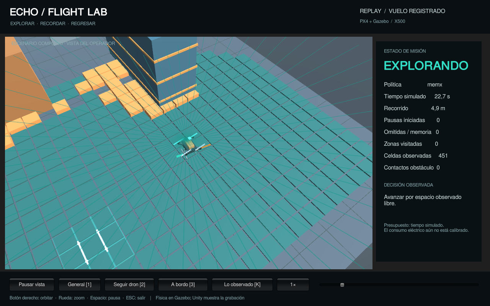

# ECHO Flight Lab

A local drone laboratory with Gazebo physics, PX4 control, an ECHO memory adapter and a passive Unity viewer.

[Watch the demo](../Media/FlightLab/ECHO-FLIGHTLAB-DEMO.mp4) · [All five clips](../Media/FlightLab/README.md) · [Recorded results](RESULTS.md)



## Replay and editing

Open `FlightLab/Unity` with **Unity 6000.0.84f1**, load `Assets/Scenes/FlightLab.unity`, and press Play. The included replay is the MEMORIA-X partial mission, copied from `Recordings/memx`. Its original frame bytes and scene are preserved. Replaying requires neither ECHO nor Gazebo.

For Linux standalone playback:

```sh
export UNITY_EDITOR='/path/to/Unity/Editor/Unity'
sh FlightLab/Tools/build.sh
sh FlightLab/Tools/view.sh --speed 4
sh FlightLab/Tools/view.sh --speed 4 --flight-dir "$PWD/FlightLab/Recordings/cache"
```

Keys: **1** overview, **2** follow, **3** onboard camera, **K** world/observed map, **Space** pause, scroll zoom, right mouse orbit. Onboard RGB is a Unity operator view, not an input to the policy. The playback speed is displayed.

## ECHO dependency

The adapter imports MEMORIA-X and WSP from the official ECHO source; it does not duplicate their implementation. Install Python **3.12+** and keep the checkouts beside each other:

```sh
git clone https://github.com/navywakura/echoai.git
# From the echounity checkout:
export ECHOAI_SOURCE="$(cd ../echoai && pwd)"
python3 -B FlightLab/Tools/flightlab.py tests
python3 -B FlightLab/Tools/flightlab.py verify
```

`ECHO-COMPATIBILITY.json` pins the tested public ECHO commit and four dependency hashes. The entry point checks those hashes and honors an explicit `ECHOAI_SOURCE` without silently substituting another installation. To reproduce with a future changed checkout, use a separate checkout of the commit recorded there.

`verify` checks the distributed inventory, runs 31 CPU tests, then replays the five saved decisions and physical-audit receipts. It reads recorded observations, never starts a simulator, never opens an examination and makes no API requests. Tests of the portable entry point are also available:

```sh
python3 -B -m unittest discover -s FlightLab/Tools -p test_portable.py -v
```

## Run a new simulated flight

New flight execution requires **Linux, systemd user services, Podman and the local PX4/Gazebo image**. The launch process is network-isolated and accepts no external MAVLink address. Unity can remain a passive viewer.

Prepare the compatible image once, using the official source recipes. Builds require network access to fetch dependencies; flights themselves run with `--network=none`. Build sequentially, with resource limits:

```sh
podman build --cpus=1 --memory=2g --memory-swap=2g   -t localhost/echoai-sim3-gz:harmonic   -f "$ECHOAI_SOURCE/nexus0/sim3/container/Containerfile"   "$ECHOAI_SOURCE/nexus0/sim3/container"
podman build --cpus=1 --memory=2g --memory-swap=2g   -t localhost/echoai-flight1s-px4:v1.15.4   -f "$ECHOAI_SOURCE/nexus0/flight1s/container/Containerfile"   "$ECHOAI_SOURCE/nexus0/flight1s/container"
podman build --cpus=1 --memory=2g --memory-swap=2g   -t localhost/echoai-flight1s-px4:v1.15.4-gpsaccuracy   -f "$ECHOAI_SOURCE/nexus0/flight1s_v5/container/Containerfile"   "$ECHOAI_SOURCE/nexus0/flight1s_v5/container"
```

These are the upstream recipes used to construct the runtime, with PX4 source pinned to 1.15.4. Package repositories can change, so rebuilding does not promise the original image digest. The saved runs record their actual image ID. Image preparation is optional if you only want the Unity replay or offline verification.

```sh
python3 -B FlightLab/Tools/flightlab.py doctor
FLIGHTLAB_WAIT=1 sh FlightLab/Tools/service.sh   --out "$PWD/FlightLab/Artifacts/my-first-flight"   --arm memx --variant warehouse --seconds 120 --inspections 4   --memory "$PWD/FlightLab/Recordings/school/memory.wsp"
```

Choose a **new output directory** for each run. New flights write `console.log`, `decisions.jsonl`, `frames.jsonl`, memory and results there. With `FLIGHTLAB_WAIT=1`, the current terminal shows actual logs and waits for completion. The supervisor limits CPU to 150%, RAM to 2300 MiB, swap to zero and wall time to 1500 s; the container has its own 1.5-CPU/2-GiB cap. A shared lock prevents a second heavy ECHO job. Launch also requires at least 3.5 GiB available host memory. The eight CPU roles from other ECHO experiments are not instantiated as heavy processes here.

To follow a live run, use the viewer with its output directory:

```sh
sh FlightLab/Tools/view.sh --flight-dir "$PWD/FlightLab/Artifacts/my-first-flight"
```

The inspection-school memory comes from 24 actual observations and four local sector rules. Its coordinate frame is declared in the archive. Old incompatible frames are rejected. A new environment requires its own appropriate preparation; months of development are not treated as a universal pre-trained memory.

## Record your own videos

The shipped clips are exact copies of the already verified local recordings. For a new verified five-case set, render and encode sequentially with the provided bounded recorder:

```sh
python3 -B FlightLab/Tools/flightlab.py record   "$PWD/FlightLab/Artifacts/new-videos"   --flights "$PWD/FlightLab/Recordings"
```

Requires the Linux Unity build, a working display and ffmpeg/ffprobe with `libopenh264`. The output must be new. Frames are linked to original Gazebo/PX4 observations; encoding and probing use limited services. Four clips play at 4× and the LiDAR-loss case at 2×. No generated trajectory is substituted for a recorded one.

## Scope of r1

Gazebo simulates a 3D X500 body, physical contacts and sensors; PX4 runs the estimator and flight control. The new CPU planner receives a 180-ray LiDAR at 8 Hz, up to 6 m, and estimated poses. It plans on a conservative 2D occupancy grid at 1.5 m estimated altitude. Simulated indoor GPS is part of this setup. The planner never receives the true obstacle map; true poses/contacts go to the viewer and separate judge.

MEMORIA-X/.wsp and the existing PX4 backend are reused from ECHO. Frontier exploration, route planning and inspection/return scheduling are new programmed adapters. This is not a claim that the full certified ECHO core is controlling the drone. Communication is MAVLink/Gazebo Transport and local files; ROS 2 integration is future work.

The measured budgets are simulated time and distance, not joules. Synchronizing sensor poses, representing uncertainty and measuring behavior on new geometries are the next development steps before Jetson/HIL/real-aircraft work.
