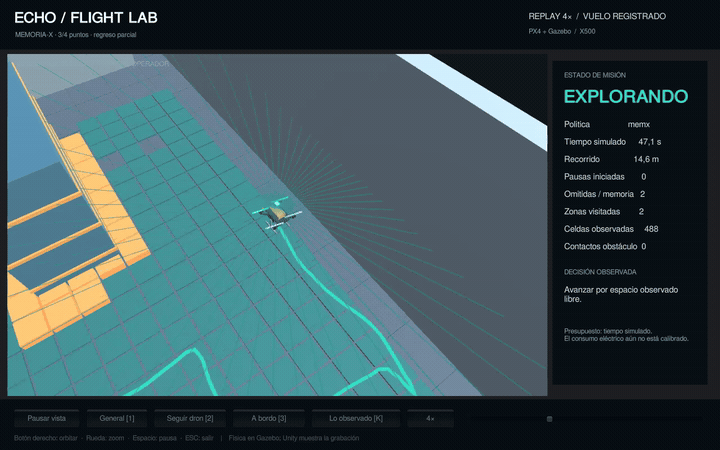

<h1 align="center">ECHO Unity · Flight Lab</h1>
<p align="center"><strong>Fly through a simulated warehouse. Observe the space. Carry memory into the next flight.</strong></p>
<p align="center">
  <a href="https://rxlabs.org">RxLabs</a> ·
  <a href="https://github.com/navywakura/echoai">ECHO-AI</a> ·
  <a href="FlightLab/README.md">Flight Lab guide</a> ·
  <a href="STATION.md">Station & arachnid</a> ·
  <a href="WorldPrototype/README.md">World Prototype</a>
</p>

[](https://github.com/navywakura/echounity/raw/refs/heads/main/Media/FlightLab/ECHO-FLIGHTLAB-DEMO.mp4)

**[Watch the full demonstration — 2 min 24 s](https://github.com/navywakura/echounity/raw/refs/heads/main/Media/FlightLab/ECHO-FLIGHTLAB-DEMO.mp4)** · [Five individual recordings](Media/FlightLab/README.md)

These are actual recorded **Gazebo/PX4 simulated flights**, shown in Unity at **4× playback**; the LiDAR-loss case is shown at **2×**. The speed is labeled on screen. Playback acceleration preserves the recorded trajectory and does not increase the simulated flight speed.

## What happens in the demo?

An X500 drone starts at its base inside a warehouse. Its LiDAR reveals the nearby space as it moves. A CPU adapter builds an observed map, chooses reachable inspection points, avoids observed obstacles and keeps time in reserve to return.

ECHO's **MEMORIA-X** stores the consequences of inspections. A `.wsp` file works like a **memory card**: save what an agent observed, load it on a later compatible flight, and reuse that experience. In this demonstration, memories refer to familiar spatial sectors of the same map.

Imagine a warehouse inspection: the first flight pauses to inspect a sector and records the result; the next can reuse that record while checking its current sensors. A newly observed obstacle changes the route. If LiDAR disappears, the adapter requests a contingency landing.

The responsibilities are explicit:

| Component | What it does |
|---|---|
| **Gazebo Harmonic** | Simulates gravity, collisions, motors and sensors in a 3D world |
| **PX4 1.15.4** | Estimates the vehicle state and controls its flight |
| **ECHO + Flight Lab adapter** | Supplies persistent memory and CPU exploration, route selection and return decisions |
| **Unity** | Shows the recorded or live flight, onboard view and observed map |

The adapter is a new robotics planner using ECHO's existing memory modules. Navigation currently plans at a fixed estimated altitude of 1.5 m. All local decisions run without an LLM or paid API.

## Try it in Unity

Install **Unity 6000.0.84f1** with Unity Hub, then:

```sh
git clone https://github.com/navywakura/echounity.git
cd echounity
```

1. In Unity Hub, choose **Add project from disk** and select **`FlightLab/Unity`**.
2. Open **`Assets/Scenes/FlightLab.unity`** and press **Play**.
3. Watch the included recorded flight. No simulator or Python setup is needed for this replay.

**Controls:** `1` overview · `2` follow · `3` onboard camera · `K` observed map/world · `Space` pause · mouse wheel zoom · right mouse button orbit. The onboard camera is an operator view; this version's policy receives LiDAR.

For a standalone **Linux** viewer, install Linux Build Support and build:

```sh
export UNITY_EDITOR='/path/to/Unity/Editor/Unity'
sh FlightLab/Tools/build.sh
sh FlightLab/Tools/view.sh --speed 4
```

To generate new flights, see the [Gazebo/PX4 setup and bounded launch commands](FlightLab/README.md#run-a-new-simulated-flight).

## What the recorded flights achieved

An inspection point is a target sector. An obstacle contact is a physical contact reported by Gazebo; ordinary ground contact during takeoff and landing is counted separately.

| Case | Inspection points | Outcome | Obstacle contacts |
|---|---:|---|---:|
| MEMORIA-X | 3/4 | Returned to base with a partial mission | 0 |
| Start without inspection memory | 3/4 | Returned to base with a partial mission | 0 |
| Simple cache control | 4/4 | Completed the mission and returned | 0 |
| New obstacle | 3/4 | Returned to base with a partial mission | 0 |
| LiDAR signal lost | 0/4 | Contingency landing away from base | 0 |

Each row is one development flight. This set demonstrates the integration and its observed behavior; the cache completed more points than MEMORIA-X, so it does not establish a memory advantage. [Recorded data, metrics and replay](FlightLab/RESULTS.md).

**Verification:** 31 CPU tests, five identical decision replays, separate checks of physical takeoff/contact evidence, and recorded video-to-frame provenance. The simulator uses simulated indoor GPS; hardware deployment follows a separate calibration and validation stage.

## Earlier projects are still here

| Project | Open in Unity Hub | Explore |
|---|---|---|
| **ECHO-Station 1.0 / mechanical arachnid** | Repository root | [Original README and recorded results](STATION.md) · [Decision inspector](STATION.md#inspect-actual-decisions) |
| **Echo MMO Prototype BETA 0.0.2** | `WorldPrototype/` | [Features, controls and screenshots](WorldPrototype/README.md) |
| **ECHO Flight Lab** | `FlightLab/Unity/` | [Setup, sensors and recording tools](FlightLab/README.md) |

Station, the arachnid, World Prototype, their assets and historical evidence are retained. Each Unity project is opened separately.

## Source and licenses

```text
FlightLab/Unity/       Editable drone viewer, scene and included replay
FlightLab/Adapter/     CPU flight adapter importing the official ECHO modules
FlightLab/Tools/       Portable launch, build, tests and read-only replay verification
FlightLab/Recordings/  Five recorded simulated flights and inspection-school memory
Media/FlightLab/       Full MP4, individual clips and screenshots
Assets/, Bridge/, …   Original Station and arachnid project, retained
WorldPrototype/       Original separate voxel-world project, retained
```

Original source is **GPL-3.0-or-later**. PX4/X500 assets retain their supplied **BSD** licenses; [Flight Lab credits](FlightLab/NOTICE.md). The original arachnid geometry remains CC0, and World Prototype retains its existing texture credits. [Repository license](LICENSE) · [Existing asset notices](NOTICE.md).
