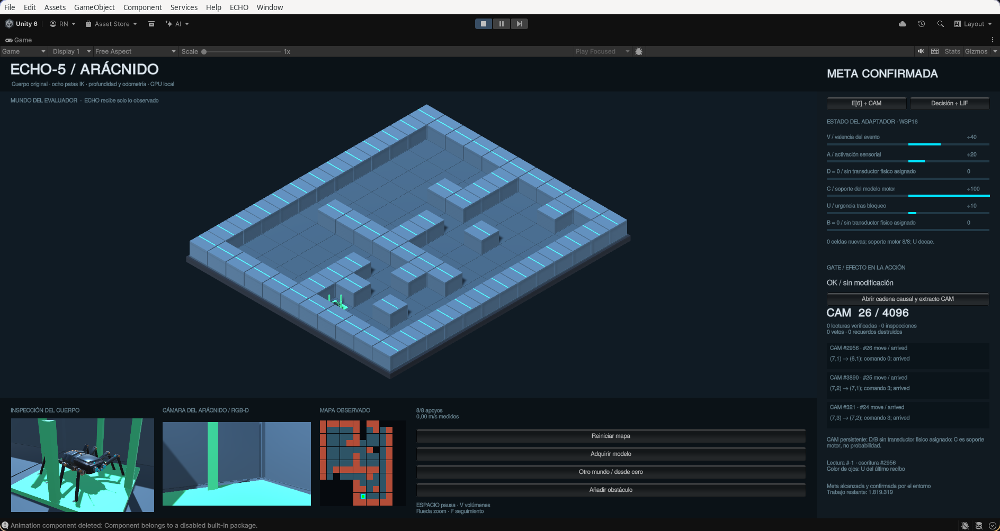
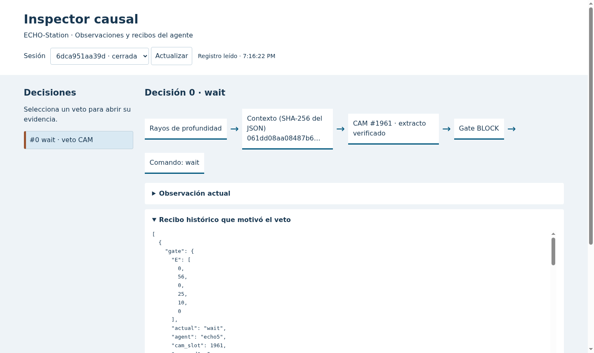

<p align="center"></p>
<h1 align="center">ECHO Unity</h1>
<p align="center">
  
  
  
  
  
</p>

Unity worlds, original models and local interfaces for [ECHO-AI](https://github.com/navywakura/echoai).
This repository contains two separate Unity projects:

- **Root — ECHO-Station 1.0:** the eight-legged mechanical arachnid, navigation laboratory, three station missions, E[6]/CAM integration and a causal inspector. Its [closure contract](Docs/Arachnid/CLOSURE-1.0.md) passed in the recorded simulation runs.
- **[WorldPrototype/](WorldPrototype/)** — **Echo MMO Prototype BETA 0.0.2:** a playable local isometric voxel world with procedural terrain, building, inventory, survival controls and local chat. Networking and ECHO NPCs are future work.

The ECHO brain stays in **navywakura/echoai** and is imported as a sibling checkout. This repository contains Unity adapters and evidence, without duplicating the ECHO implementation. S6 is separate research deferred until after ECHO-5.5.

## Run the arachnid

Use Unity **6000.0.84f1** and Python **3**. The bridge uses the standard library; Blender is optional for editing the original model.

```sh
git clone https://github.com/navywakura/echoai.git
git clone https://github.com/navywakura/echounity.git
cd echounity
export UNITY_EDITOR='/path/to/Unity/Editor/Unity'
python3 -B Tools/start_arachnid.py --no-blender
```

Enter Play mode in `Assets/Scenes/ECHO5_ArachnidLab.unity`. The launcher starts the local bridge on **127.0.0.1:8771**. The browser inspector is at **http://127.0.0.1:8771/**. To use a different checkout layout, set `ECHOAI_SOURCE` or `ECHO5_SOURCE`; see [setup and verification](Docs/REPRODUCE.md).

```sh
python3 -B Tools/start_arachnid.py --bridge-only         # use an already open editor
python3 -B Tools/start_arachnid.py --station --no-blender # irrigation, delivery, detour
python3 -B Tools/launch.py                              # historical NavigationLab, port 8770
```

The arachnid has eight articulated legs with procedural IK, original Blender/FBX/GLB assets, four emissive optical sensors and a first-person RGB camera. Its controller uses **simulated depth and odometry**, not learned recognition from RGB. It accumulates an observed map and learns the effects of four movement commands. Planning, sensor integration, task dependencies and locomotion are programmed algorithms.

E[6] records measured consequence signals. CAM stores verified episodes, persists its 4,096 slots and can inhibit a previously blocked command in the same compatible context. New depth evidence can retire that inhibition while preserving the episode. D and B have no physical transducer in this demo. The 256-unit LIF observer is explicitly **passive: `drives_policy = false`**.

## Inspect actual decisions



Select a CAM veto to inspect **observation → context → memory slot and SHA-256 → gate → executed command**. The viewer reads the existing `thought.jsonl`; it neither fabricates inner speech nor feeds explanations back to the actor. No LLM is required.

## Recorded Station 1.0 results

| Check | Recorded result |
|---|---|
| Controlled physical conditioning | 6/6 checks: second encounter, safe context, extinction, restart and paired control |
| Development navigation and station missions | 8/8 maps + 3/3 missions |
| Fresh held-out maps | 16/16; four families; no irrecoverable blocks |
| Journal audit | 34/34 valid |
| Software and geometry | 121 Python tests; 22 world checks; 12 motion checks |
| Brain RSS, sampled every 50 ms | Peak 35.08 MB in development; Unity excluded |
| Offline test | Complete CPU geometric mission; zero external packets in a loopback-only namespace |

These are **bounded simulation results**, not universal intelligence, biological learning, zero-error guarantees or measured power savings. The conditioning test fixes the proposed command to isolate memory; the held-out navigation test is separate. The offline run does not include Unity/PhysX. [Full methodology, metrics and limits](Docs/Arachnid/CLOSURE-1.0.md).

The [archive](Evidence/INDEX.md) includes complete historical records and unsuccessful runs with original hashes. The [publication report](Docs/PUBLICATION-20261012.md) separately records checks of this portable export. Original closure manifests describe the original execution, not subsequent packaging edits.

## World Prototype BETA 0.0.2

Open **WorldPrototype/** as a separate project in Unity Hub, or:

```sh
python3 WorldPrototype/Tools/world.py open
```

Procedural chunks, biomes, caves and trees; click/WASD movement; manual jump; blocks and magnetized drops; ten inventory slots; torches; 20 HP; stamina; fall damage; a 15-minute day and 15-minute night; local speech bubbles and a pause/restart menu. See [features, controls and screenshots](WorldPrototype/README.md).

The coordinate range and chunk system do not demonstrate a 200-player MMO. Multiplayer, public/private servers, factions, enemies, XP progression and ECHO-controlled NPCs are not implemented.

## Source and verification

```text
Assets/               Station, NavigationLab and ArachnidLab scenes, C# and prefabs
ArtSource/            Original Blender model, exports, render and generation report
Bridge/               Local HTTP service, E6/CAM, causal inspector and Python tests
Tools/                Launchers, Blender generator, checks, resource measurement and audits
Docs/                 Design, measured results, closure contract and asset notices
Evidence/             Original scientific records, including unsuccessful development
Media/                Real captures and provenance
WorldPrototype/       Separate playable voxel-world Unity project
```

Bounded checks without running a new confirmation:

```sh
python3 -B Tools/check.py --worker --python-only
python3 -B Tools/check_evidence.py --tamper-tests
python3 -B Tools/check_publication.py
python3 -B WorldPrototype/Tools/world.py verify
```

For **new development runs** with this root project closed in Unity:

```sh
python3 -B Tools/check.py --integration --development-only
```

Omitting `--development-only` deliberately opens a **new** frozen-source confirmation after development passes; it does not replay the archived examination. The complete pipeline needs Linux user/network namespaces, `ip` and `psutil` in the selected Python environment.

## Assets and licenses

Original code: **GPL-3.0-or-later**. Original arachnid geometry/materials: **CC0-1.0**, with [its asset notice](ArtSource/ECHO5_Arachnid/ASSET-NOTICE.md). Redistributable WorldPrototype textures retain their individual [credits](WorldPrototype/Docs/ASSETS.md).

Adventure Forge source artwork and standalone atlases without confirmed redistribution terms are excluded. The public worlds have visual fallbacks; historical captures can depict optional local artwork. No editor caches, private agent configuration or browser profiles are distributed. See [NOTICE.md](NOTICE.md) and [local asset import](Docs/ASSETS.md).
