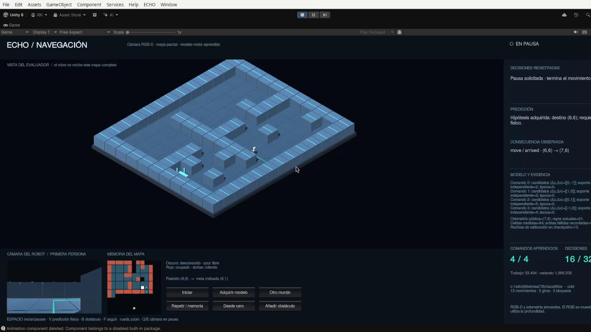
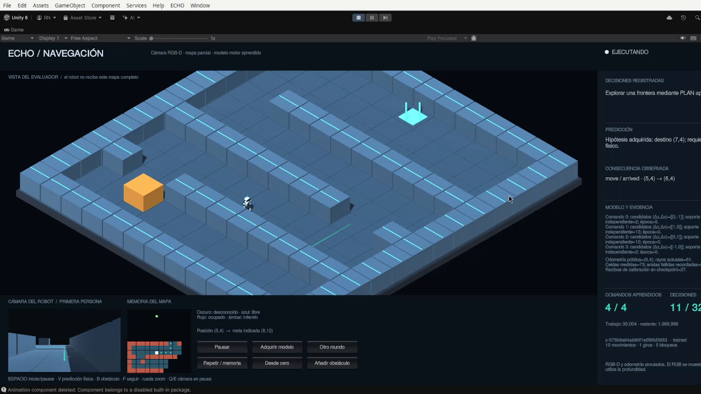
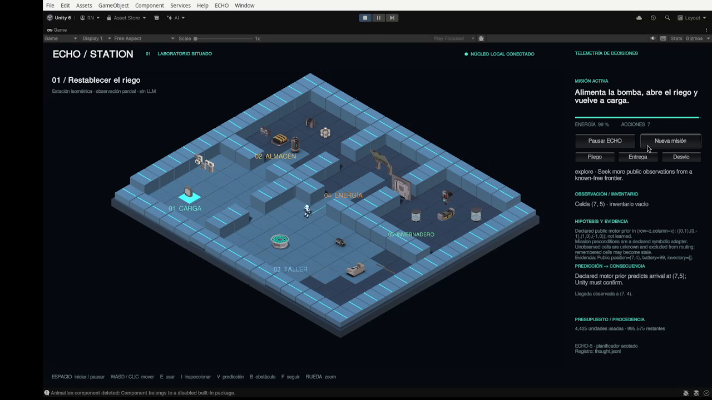

<p align="center"></p>
<h1 align="center">ECHO Unity</h1>
<p align="center">
  
  
  
  
</p>

A Unity sandbox for watching [ECHO-AI](https://github.com/navywakura/echoai)
observe, build a map, test a movement model and act. It contains an isometric
3D robot, a first-person camera, an accumulated observation map and a panel
showing hypotheses, actions and measured consequences.

**ECHO-5 is still under investigation.** These scenes and navigation results do
not certify its full release or S6. The screenshots are genuine frames from
development recordings, with [timestamps and hashes](Media/PROVENANCE.json).
The public project includes original geometry and placeholder visuals;
third-party artwork visible in the recordings is an optional local import.

## Open the project

Use Unity **6000.0.84f1**, Python **3** and the complete official ECHO-AI
checkout. The bridge uses the standard library; ECHO-5's scientific reference
runtime is CPython 3.12.13. Keep the two repositories beside each other:

```sh
git clone https://github.com/navywakura/echoai.git
git clone https://github.com/navywakura/echounity.git
cd echounity
export UNITY_EDITOR='/path/to/Unity/Editor/Unity'
python3 -B Tools/launch.py
```

The launcher starts a local Python bridge at `127.0.0.1:8770` and opens
`Assets/Scenes/NavigationLab.unity`. Enter Play mode, then press **Iniciar**
or Space. Alternatively, open this folder through Unity Hub and run only
the bridge with `Tools/launch.py --bridge-only` using the same Python.

The launcher and automated editor checks are primarily developed on Linux.
For a different directory layout, set `ECHOAI_SOURCE` to the ECHO-AI checkout,
or `ECHO5_SOURCE` directly to its `ECHO-5/` folder. Unity is a separate
installation; its editor, generated caches and binaries are not bundled.

## Navigation Lab

The robot starts with partial observations. It integrates depth rays and
odometry into an occupancy map, retains explored areas and plans through its
current map. A bounded hypothesis model learns the observed effects of four
movement commands. The first-person RGB view is a real Unity camera; **the
policy currently uses depth and odometry, not learned recognition from RGB**.

- **Adquirir modelo** opens an acquisition world; **Iniciar** runs it.
- **Otro mundo** changes the development map while retaining the acquired model.
- **Repetir / memoria** revisits the same world with its remembered map.
- **Desde cero** resets the relevant learned state for comparison.
- **Añadir obstáculo** changes the world so the robot must react to new evidence.



Sensor geometry, map integration, frontier selection, path search and low-level
locomotion are programmed algorithms. The learned component is the limited
command-effect model. The full world shown to the viewer is not supplied as
the robot's hidden map. [Design and limitations](Docs/Navigation/DESIGN.md) ·
[Panel controls](Docs/Navigation/USO.md).

## Station missions

Open `Assets/Scenes/EchoStation.unity`, or launch with `--classic`:

```sh
python3 -B Tools/launch.py --classic
```

The original station has storage, workshop, energy, greenhouse and charging
areas. Its three missions restore irrigation, deliver a parcel and deal with
a blocked route, each with a return to the charging area.



Space starts or pauses ECHO; WASD or a floor click moves manually; **E / I**
uses or inspects the nearest object. **V** shows curved predictive collision
volumes, **B** adds an obstacle and **F** follows the robot. Scroll zooms,
middle drag pans and Home restores the camera.

The robot and procedural animation are original geometry. Curved capsules
in front and behind anticipate collisions, followed by bounded physical
movement. This is an engineered motor controller. Mission dependencies are
explicit knowledge in the adapter; the station does not demonstrate that
ECHO independently discovered those rules.

## Evidence and limits

Navigation revision 2 solved **16/16 held-out CPU maps**, compared with
**15/16** learning from scratch and **0/16** without a persistent map. The
acquired-model arm used 427 evaluation actions; acquisition added 67 actions.
Seven separate Unity simulation episodes covered four acquisition and three
development runs. These are distinct experiments, not 23 held-out successes.

The original station previously completed **3/3 integrated missions**.
Published screenshots show those local development environments. The portable
export changes source paths and replaces optional art with placeholders; its
packaging checks do not re-certify the historical Unity runs.

Read [navigation results](Docs/Navigation/RESULTS.md),
[the protocol](Docs/Navigation/PROTOCOL.md) and
[station verification](Docs/VERIFICATION.md) for controls, acquisition costs,
audits and limitations. The Gazebo/PX4 confirmation required for ECHO-5
remains a separate unresolved gate. S6 is deferred until after ECHO-5.5.

The bridge reuses ECHO-5's `HypothesisAgent`, `Budget` and `Recorder`.
No LLM runs in these demonstrations. The display explains recorded evidence;
it does not fabricate an inner monologue or feed its text back to the policy.

## Source and checks

```text
Assets/Echo/       Robot, sensing, world rules, UI and editor checks
Assets/Scenes/     NavigationLab and EchoStation
Assets/StreamingAssets/  Navigation world definitions
Bridge/            Python policy adapter, HTTP server and tests
Tools/             Launch, evaluation, audit and optional import tools
Docs/              Designs, protocols, results and asset notices
Media/             Frames from the original recordings and provenance
Packages/          Unity package declarations and lock
ProjectSettings/   Portable Unity project settings
```

With the sibling ECHO-AI checkout installed, bounded bridge tests run without
opening Unity:

```sh
python3 -B Tools/check.py --worker --python-only
python3 -B Tools/check_evidence.py --tamper-tests
```

For full editor checks, close this project's editor first and use
`Tools/check.py --integration` or `Tools/check_navigation.py` with the same
Python and `UNITY_EDITOR`. These write local `Logs/` and `Artifacts/` and
must not share an active scientific run. See the tool's `--help` and protocol
before starting a benchmark. Installing or opening the project does not run
an exam automatically. [Complete setup guide](Docs/REPRODUCE.md) ·
[Publication checks](Docs/PUBLICATION.md) · [Historical evidence](Evidence/INDEX.md).

## Artwork and license

The public scene works with original geometry and placeholder props. The
recordings also show [Adventure Forge — Sci-fi Spaceship](https://adventureforge.itch.io/adventureforge-scifi-spaceship-pack)
by Endless Adventures / Adventure Forge. The original pack is not redistributed.
[Asset instructions and terms](Docs/ASSETS.md) explain optional local import
and which files are excluded.

Original project code uses [GPL-3.0-or-later](LICENSE), matching the ECHO-AI source
distribution. It grants no rights to separately licensed third-party art.
