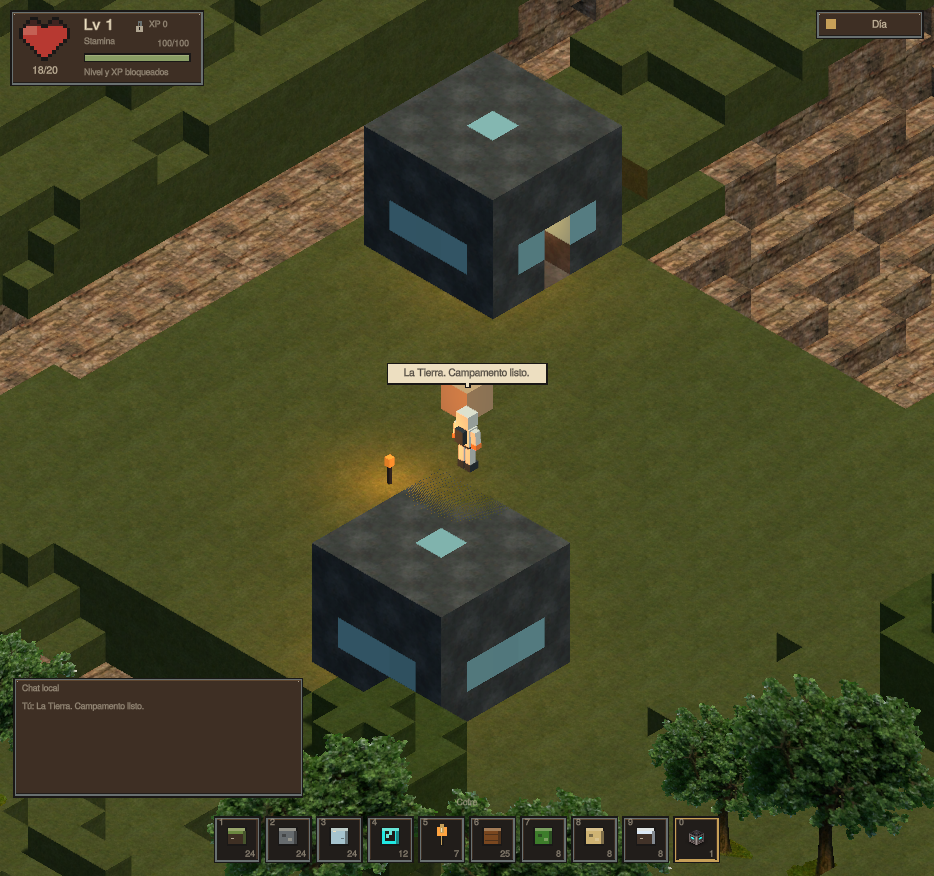
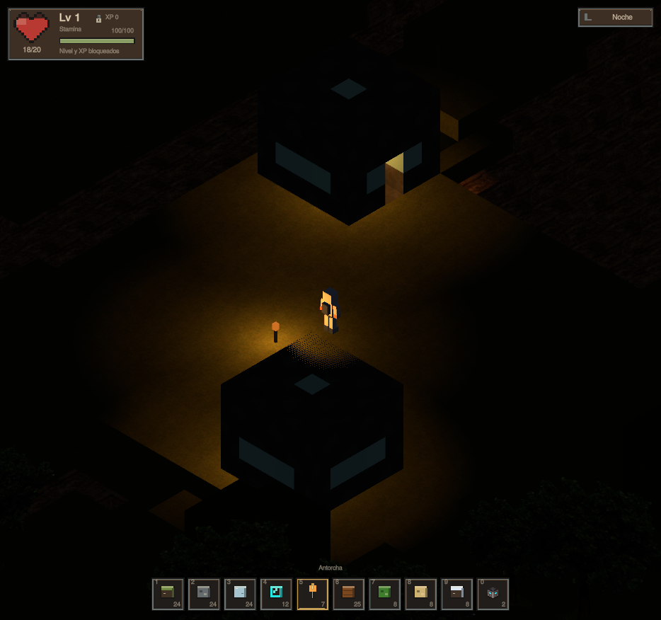
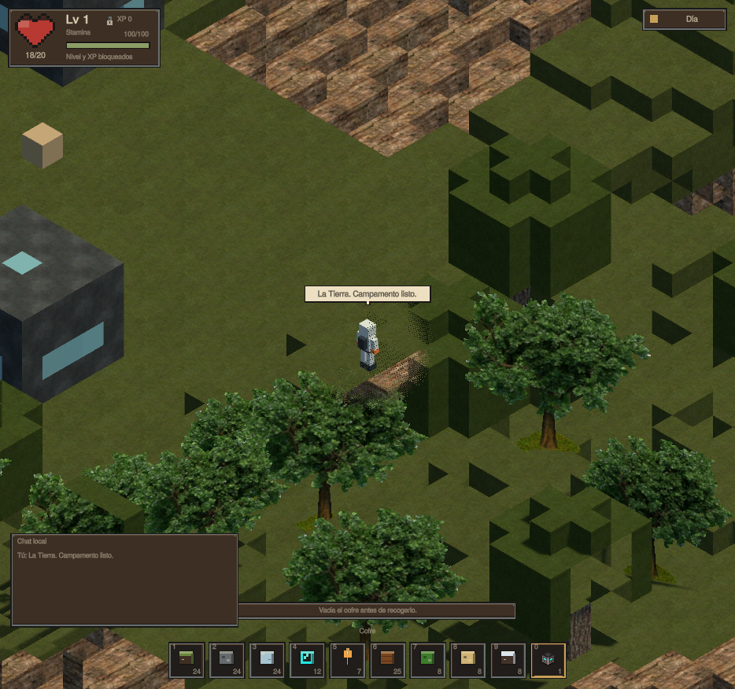
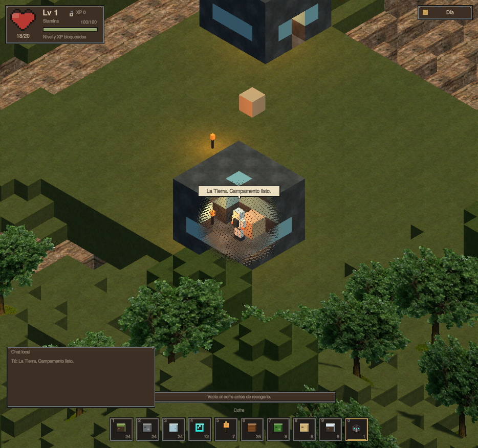
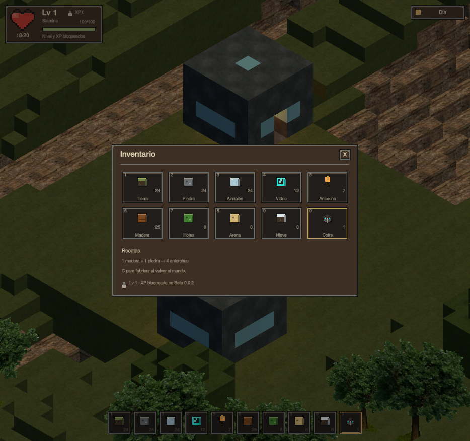
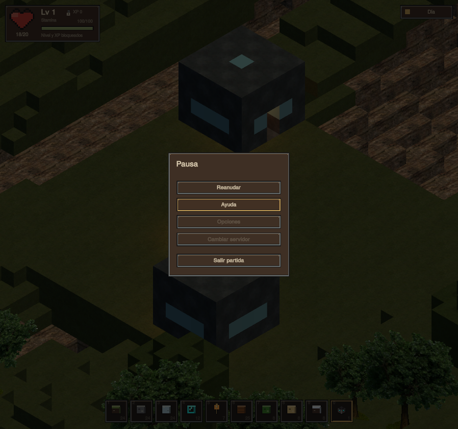

# BETA 0.0.2 · comprobación del 11 de octubre de 2026

La entrega se verificó en Unity **6000.0.84f1**, Linux: **52 comprobaciones/grupos de editor** y **40 condiciones de Play en cada una de dos semillas**, `72831` y `733173`. Los tres recibos finales tienen `valid: true`, listas de fallos vacías y códigos de salida cero. Las pruebas de Play usan guardados temporales independientes; no modifican las partidas personales.

La batería final de editor quedó registrada a las **06:33:14 de Madrid**. El Play de la semilla inicial `72831` terminó a las **06:33:54** y el de `733173` a las **06:34:54**. Son fechas de los recibos; los logs conservan además los intentos previos que detectaron fallos y llevaron a correcciones.

- [Recibo de editor](evidence/verification.json): datos, generación, rutas, mallas, colisiones, persistencia, inventario, vida/stamina y estados del HUD.
- [Recibo de Play, semilla 72831](evidence/play-smoke.json).
- [Recibo de Play, semilla 733173](evidence/play-smoke-seed-733173.json).
- [Hashes del código, configuración y recursos comprobados](evidence/source-sha256.json).
- [Inventario de assets y sus bytes originales](ASSET-MANIFEST.json).

Las capturas siguientes proceden del render real de Unity durante esas pruebas:

El editor comprueba los cinco biomas, cuevas y estructuras deterministas, cambios de semilla y orden de carga, conservación de ediciones, coordenadas negativas, límites, y el camino diagonal frente a un oráculo Dijkstra independiente. La malla se contrasta contra los bloques de autoridad, incluidas caras de cuevas y colisiones que deben conservarse aunque cambie la representación de los árboles. También se comprueba la ausencia de ascensos y cruces diagonales por esquinas bloqueadas.

Play recorre un destino, coloca y extrae un bloque, verifica que primero aparece el material caído y que la recogida transfiere exactamente una unidad. Una pared interrumpe la atracción y no se permite encerrar un drop colocando un bloque sobre él. Un movimiento horizontal contra un escalón no lo sube; el salto manual sí lo supera. Se prueban caídas físicas desde cinco bloques tanto directamente como al salir de un borde, guardando y reanudando esta última a mitad de caída. La medida final de ese caso fue **5,02 bloques, 2 HP de daño**. Las fronteras de 4,999/5/8/14 bloques también se comprueban en la regla de daño.

Las pruebas ejercitan luces de antorchas, inventario/cofres, prioridad de Escape, envío de chat, congelación del reloj en pausa, rotación de cámara y origen móvil en coordenadas de un millón de bloques. Se colocan más de 24 antorchas: el límite desactiva luces lejanas, conservando su geometría y selección. Los límites día/noche se comprueban en 900 y 1.800 segundos; no se presenta esto como un ensayo de 30 minutos de duración real.

El guardado usa un directorio de trabajo y checkpoints completos publicados por `CURRENT`. La batería de editor usa archivos `.ewd` reales y simula un fallo de escritura del puntero: al reabrir, inventario y terreno deben corresponder a la misma generación anterior. Después comprueba una publicación correcta. Play reabre el checkpoint y comprueba el cofre, la antorcha y el inventario mediante nuevas instancias de los lectores. Guardar sólo JSON habría perdido las ediciones del terreno; ese error se detectó en revisión y se corrigió antes de esta entrega. Una salida desde el menú no se ejecuta si el guardado falla.

Se corrigieron además la pérdida de altura al deslizar la cápsula por un borde, el borrado de esa altura al reanudar, el desfase de la cámara al girar y la desaparición de antorchas por confundir el límite de luces con el de objetos. El shader conserva el suelo de apoyo opaco y sólo desvanece las superficies superiores que pueden ocultar al personaje.

En el punto final de la semilla `72831` había **25 columnas gráficas**, **49 columnas de datos** y **425.772 vértices**. Unity informó de **248.161.844 bytes** asignados (~236,7 MiB, editor incluido); recorrer siete bloques tardó **1,717 s**. La otra semilla terminó con 411.572 vértices y 236.537.057 bytes. Son mediciones de estas escenas y este equipo, sin afirmación de rendimiento para un servidor MMO.

Las pruebas de Play invocan las mismas funciones de destino, inventario y chat que usa la interfaz. Para los bordes y escalones aplican desplazamientos al CharacterController real; no inyectan pulsaciones del teclado/ratón del sistema operativo. Las capturas se inspeccionaron para revisar la apariencia del humanoide y del mundo; las poses procedurales se derivan de la velocidad y del estado de salto. Esta batería no mide la calidad estética de las animaciones. No se han probado sesiones de varias horas, todos los mapas posibles, fallo físico de disco o cortes de corriente reales. Opciones, servidores y XP permanecen deshabilitados; no hay enemigos, chat de red ni NPC ECHO.

- [x] Cinco biomas, ruido, montañas, cuevas y árboles.
- [x] Tierra como entorno inicial, dos casas sci-fi y cofres de suministros.
- [x] Texturas aportadas, atlas de árboles y shader de oclusión con colisión conservada.
- [x] WASD, clic con anillo y ruta diagonal mínima dentro del presupuesto.
- [x] Caminar/correr/saltar con animación; salto manual y sin subida automática.
- [x] Diez ranuras, inventario E, chat T/Enter, burbuja y cierre prioritario con Escape.
- [x] Corazón de 20 HP, stamina y daño progresivo desde cinco bloques.
- [x] Drops visibles, recogida magnética, capacidad y línea de visión.
- [x] Cofres con transferencias conservativas y receta de antorchas.
- [x] Luces de antorchas y reloj de 15 minutos de día + 15 de noche.
- [x] Menú de pausa con ayuda; opciones/servidor bloqueados; nivel 1 y XP bloqueada.
- [x] Partida persistente, checkpoints conjuntos y archivos originales conservados.
- [x] Dos ejecuciones gráficas, recibos, capturas y documentación.
- [ ] Multijugador, enemigos, XP, facciones y NPC ECHO: futuras versiones.

Los logs íntegros quedan en `Logs/verify-20261011T043308Z/`, `Logs/smoke-20261011T043325Z/` y `Logs/smoke-20261011T043426Z/`. La validación anterior de la beta inicial se conserva en `evidence/beta-0.0.1/`. Este resultado corresponde al juego local y no cierra la investigación científica de ECHO-5.

Unity quedó reabierto en Play con la semilla inicial 72831; el arranque normal
registra `Echo MMO Prototype BETA 0.0.2 ready` en
`Logs/open-20261011T043641Z/editor.log`.

Actualización del 11 de octubre, **06:47 de Madrid**: se añadió **Esc → Reiniciar partida**, con la misma reaparición que la muerte normal. Restaura 20 HP y 100 stamina, cancela ruta y caída, vuelve al campamento, reanuda el juego y guarda. Conserva inventario, terreno y reloj. La nueva ejecución gráfica en la semilla `72831` superó **44/44 condiciones**, incluidas cuatro comprobaciones de reinicio, conservación, guardado y muerte normal. Se invocó el mismo callback que utiliza el botón; la captura confirma su disposición en el menú. Esta ejecución no repitió la batería de editor ni la segunda semilla descritas anteriormente.

- [Recibo de Play tras añadir el reinicio](evidence/restart-play-smoke.json).
- [Captura del menú actualizado](evidence/restart-pause.png).
- [Hashes de las fuentes probadas en esta actualización](evidence/restart-source-sha256.json).

Log: `Logs/smoke-20261011T044628Z/editor.log`. Las pruebas usaron un guardado temporal y se conservó una copia del checkpoint personal antes de cerrar el editor.
